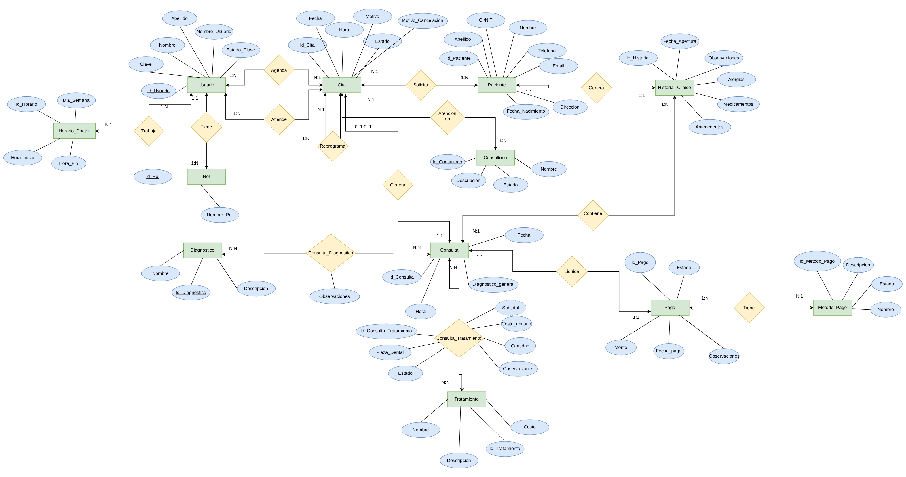

# Clínica Odontológica "Sonríe Odontología Integral"

# 1. Descripción del problema o problemática

La clínica presenta dificultades en la organización y control de las citas y de la información generada durante la atención de los pacientes debido a que actualmente estos procesos se realizan de forma manual. Los datos se encuentran registrados en diferentes medios, como agendas, fichas físicas, anotaciones y teléfonos, lo que dificulta su consulta y seguimiento.

Esta situación puede ocasionar pérdida de tiempo al buscar información, dificultades para revisar el historial de las atenciones anteriores y complicaciones para llevar un control adecuado de las citas, diagnósticos, tratamientos y pagos.

Por ello, se identifica la necesidad de contar con una base de datos que permita centralizar y organizar la información de los pacientes, citas y atenciones odontológicas, facilitando su registro, consulta y seguimiento.

# Narración del cliente

Actualmente, en la clínica llevamos el control de las citas y la atención de los pacientes de forma manual. Cuando un paciente quiere sacar una cita, anotamos su nombre, la fecha, la hora y el motivo de la consulta en una agenda o en el celular. También tenemos fichas donde vamos registrando la información de las atenciones que se realizan.

Para organizar las citas tenemos que revisar constantemente los horarios disponibles de los doctores y de los consultorios. Cuando un paciente cancela o no se presenta, lo anotamos para tenerlo en cuenta y poder reorganizar la agenda. El problema es que, al manejar la información de esta manera, algunas veces cuesta encontrar rápidamente los datos de un paciente o recordar qué atención recibió anteriormente.

Con los pacientes que ya han venido varias veces también tenemos que buscar sus fichas anteriores para revisar sus diagnósticos, tratamientos y observaciones. Esto puede tomar tiempo, especialmente cuando se necesita consultar información de una atención pasada.

En cuanto a los pagos, normalmente los registramos de forma manual y tratamos de relacionarlos con la atención realizada. Aunque este método nos permite trabajar actualmente, consideramos que podría ser más eficiente si toda la información estuviera organizada en un solo lugar y pudiéramos encontrarla rápidamente.

Lo que más nos gustaría mejorar es la organización de las citas y de la información de los pacientes. También sería útil tener un mejor control de las consultas realizadas, los diagnósticos, tratamientos y pagos, sin tener que revisar diferentes agendas, fichas o anotaciones.

# 2. Preguntas y respuestas de la entrevista

### 1. ¿Cómo registran actualmente las citas de los pacientes?

Actualmente las citas las vamos anotando de forma manual, principalmente en una agenda y, en algunos casos, en el celular. Ahí vamos colocando la fecha, hora y nombre del paciente.

### 2. ¿Qué información solicitan cuando un paciente quiere sacar una cita?

Normalmente pedimos el nombre del paciente, número de teléfono, el motivo de la consulta y el día y hora que desea. Si es un paciente que ya conocemos, también revisamos sus datos anteriores.

### 3. ¿Quién se encarga de registrar las citas?

Generalmente la persona que está encargada de la atención en ese momento es quien anota la cita. Dependiendo del día, puede hacerlo la recepción o alguno de los doctores.

### 4. ¿Un paciente puede tener más de una cita?

Sí, claro. Un paciente puede venir varias veces, dependiendo del tratamiento que necesite. Por ejemplo, puede tener una cita para una revisión y después otras para continuar con su tratamiento.

### 5. ¿Cómo saben qué doctor atenderá al paciente?

Lo coordinamos de acuerdo con la disponibilidad del doctor y el tipo de atención que necesita el paciente. Normalmente lo anotamos junto con la cita para saber quién estará encargado.

### 6. ¿Cómo asignan el consultorio para cada cita?

Se revisa qué consultorio está disponible y se coordina con el doctor que atenderá. Esto normalmente lo tenemos presente en la agenda o lo comunicamos entre nosotros.

### 7. ¿Qué pasa cuando un paciente cancela o no se presenta?

Cuando cancela, simplemente anotamos que la cita fue cancelada y, si desea, se le busca otro horario. Si no se presenta, normalmente lo registramos en la agenda para tenerlo en cuenta.

### 8. ¿Qué información registran cuando se atiende a un paciente?

Anotamos los datos más importantes de la atención, como el motivo por el que vino, lo que se encontró durante la revisión, el diagnóstico y el tratamiento que se realizó o que se recomienda.

### 9. ¿Cómo registran actualmente los diagnósticos?

Los diagnósticos se anotan de manera manual en las fichas o registros del paciente. Dependiendo de la atención, se pueden registrar uno o varios diagnósticos.

### 10. ¿Un paciente puede recibir varios tratamientos durante una misma consulta?

Sí. En una misma consulta se puede realizar más de un procedimiento o tratamiento, dependiendo de lo que necesite el paciente.

### 11. ¿Cómo llevan el historial de los pacientes?

Tenemos los datos y antecedentes en registros físicos y fichas de los pacientes. Cuando vuelve una persona, buscamos su información para revisar lo que se le realizó anteriormente.

### 12. ¿Qué información guardan sobre los tratamientos?

Principalmente anotamos qué tratamiento se realizó, la cantidad o las veces que se realizó y algunas observaciones relacionadas con la atención.

### 13. ¿El costo de un tratamiento puede cambiar con el tiempo?

Sí, los precios pueden cambiar. Por eso es importante saber cuánto costaba el tratamiento en el momento en que se atendió al paciente y no solamente tener el precio actual.

### 14. ¿Cómo registran actualmente los pagos?

Los pagos se registran de manera manual. Normalmente anotamos cuánto pagó el paciente y lo relacionamos con la atención que recibió.

### 15. ¿Qué métodos de pago reciben?

Recibimos principalmente efectivo, tarjeta, QR y transferencia, dependiendo de la disponibilidad y de lo que prefiera el paciente.

### 16. ¿Permiten realizar pagos parciales?

Actualmente, por lo general, se trata de completar el pago correspondiente a la atención. Si se presenta algún caso diferente, se coordina directamente con el paciente.

### 17. ¿Quiénes necesitan consultar la información de los pacientes?

Principalmente los doctores y la persona encargada de la atención o administración, porque necesitan consultar las citas, los datos del paciente y la información de las atenciones anteriores.

### 18. ¿Qué información sería importante poder consultar rápidamente?

Sería útil poder buscar rápidamente los datos del paciente, sus próximas citas, las consultas anteriores, los diagnósticos y tratamientos que recibió, además de los pagos realizados.

### 19. ¿Qué problemas tienen actualmente al trabajar de esta manera?

El principal problema es que la información está distribuida entre agendas, fichas y anotaciones. A veces cuesta encontrar rápidamente los datos de un paciente o saber qué se hizo en una consulta anterior. También puede ser difícil llevar un control ordenado de las citas y los pagos.

### 20. ¿Qué espera obtener con un sistema para la clínica?

Esperamos poder tener toda la información más organizada en un solo lugar, poder consultar los datos de los pacientes y sus historiales con mayor facilidad, controlar mejor las citas y tener un registro más ordenado de las consultas, tratamientos y pagos.

# 3. Diseño de la solución

### Entidades y atributos

**ROL:** ID_ROL, NOMBRE_ROL

**USUARIO:** ID_USUARIO, NOMBRE, APELLIDO, NOMBRE_USUARIO, CLAVE, ESTADO_CLAVE

**HORARIO_DOCTOR:** ID_HORARIO, DIA_SEMANA, HORA_INICIO, HORA_FIN

**PACIENTE:** ID_PACIENTE, CI/NIT, NOMBRE, APELLIDO, FECHA_NACIMIENTO, TELEFONO, EMAIL, DIRECCION

**HISTORIAL_CLINICO:** ID_HISTORIAL, FECHA_APERTURA, ANTECEDENTES, ALERGIAS, MEDICAMENTOS, OBSERVACIONES

**CONSULTORIO:** ID_CONSULTORIO, NOMBRE, DESCRIPCION, ESTADO

**CITA:** ID_CITA, FECHA, HORA, MOTIVO, ESTADO, MOTIVO_CANCELACION

**CONSULTA:** ID_CONSULTA, FECHA, HORA, DIAGNOSTICO_GENERAL

**DIAGNOSTICO:** ID_DIAGNOSTICO, NOMBRE, DESCRIPCION

**CONSULTA_DIAGNOSTICO:** OBSERVACIONES

**TRATAMIENTO:** ID_TRATAMIENTO, NOMBRE, DESCRIPCION, COSTO

**CONSULTA_TRATAMIENTO:** ID_CONSULTA_TRATAMIENTO, PIEZA_DENTAL, ESTADO, CANTIDAD, COSTO_UNITARIO, SUBTOTAL, OBSERVACIONES

**METODO_PAGO:** ID_METODO_PAGO, NOMBRE, DESCRIPCION, ESTADO

**PAGO:** ID_PAGO, FECHA_PAGO, MONTO, ESTADO, OBSERVACIONES

### Descripción de los atributos nuevos

| Entidad | Atributo | Descripción |
|---|---|---|
| HORARIO_DOCTOR | DIA_SEMANA, HORA_INICIO, HORA_FIN | Turnos de atención de cada doctor (1 = lunes ... 7 = domingo). Permite conocer su disponibilidad al agendar una cita. |
| PACIENTE | FECHA_NACIMIENTO, DIRECCION | Datos personales complementarios del paciente. |
| HISTORIAL_CLINICO | ANTECEDENTES, ALERGIAS, MEDICAMENTOS | Información médica relevante del paciente antes de recibir un tratamiento. |
| CITA | MOTIVO_CANCELACION | Razón por la que se canceló la cita (solo aplica si el estado es *Cancelada*). |
| CONSULTA_TRATAMIENTO | PIEZA_DENTAL | Pieza dental tratada, en notación FDI (por ejemplo 16 o 48). Si queda vacía, el tratamiento es general (limpieza, revisión, etc.). |
| CONSULTA_TRATAMIENTO | ESTADO | Indica si el tratamiento está *Recomendado*, *En curso* o *Realizado*. |

# 4. Uniones o cardinalidades

ROL -> USUARIO (1,N)

USUARIO -> HORARIO_DOCTOR (1,N)

PACIENTE -> HISTORIAL_CLINICO (1,1)

PACIENTE -> CITA (1,N)

USUARIO -> CITA (1,N) [AGENDA]

USUARIO -> CITA (1,N) [ATIENDE]

CONSULTORIO -> CITA (1,N)

CITA -> CITA (1,0..1) [REPROGRAMA: una cita nueva puede provenir de una cita cancelada]

CITA -> CONSULTA (1,0..1)

HISTORIAL_CLINICO -> CONSULTA (1,N)

CONSULTA -> DIAGNOSTICO (N,N)

CONSULTA -> CONSULTA_DIAGNOSTICO (1,N)

DIAGNOSTICO -> CONSULTA_DIAGNOSTICO (1,N)

CONSULTA -> TRATAMIENTO (N,N)

CONSULTA -> CONSULTA_TRATAMIENTO (1,N)

TRATAMIENTO -> CONSULTA_TRATAMIENTO (1,N)

CONSULTA -> PAGO (1,0..1)

METODO_PAGO -> PAGO (1,N)

# Relaciones N:N

La relación entre **CONSULTA y DIAGNOSTICO** es de muchos a muchos y se resuelve mediante **CONSULTA_DIAGNOSTICO**.

La relación entre **CONSULTA y TRATAMIENTO** es de muchos a muchos y se resuelve mediante **CONSULTA_TRATAMIENTO**. Esta tabla tiene su propia clave (ID_CONSULTA_TRATAMIENTO) porque un mismo tratamiento puede aplicarse a varias piezas dentales dentro de una misma consulta.

# Atributos calculados

El **SUBTOTAL** de CONSULTA_TRATAMIENTO se obtiene mediante:

**SUBTOTAL = CANTIDAD × COSTO_UNITARIO**

El **COSTO_UNITARIO** guarda el precio del tratamiento vigente al momento de la atención, de modo que un cambio posterior en el costo no altera las consultas anteriores.

El **TOTAL de una consulta** se obtiene mediante la suma de los subtotales de los tratamientos asociados a dicha consulta:

**TOTAL = SUMA(SUBTOTAL)**

El **MONTO** de PAGO corresponde a lo que efectivamente pagó el paciente, y se registra aparte del total calculado.

Estos valores pueden calcularse mediante consultas SQL y no necesariamente necesitan almacenarse físicamente en la base de datos.

# 5. Reglas de negocio y restricciones

* Un doctor o un consultorio no pueden tener dos citas activas en la misma fecha y hora. Las citas canceladas no bloquean el horario, lo que permite reprogramar.
* El horario de atención de las citas es de 07:00 a 21:00.
* Una cita puede generar como máximo una consulta, y una consulta puede existir sin cita previa (urgencias).
* Una consulta tiene como máximo un pago, y el monto no puede ser negativo.
* El costo de un tratamiento y el costo unitario deben ser mayores que cero.
* La cantidad de un tratamiento por consulta debe estar entre 1 y 100.
* Los estados de citas, consultorios, pagos, métodos de pago, claves y tratamientos de una consulta solo admiten valores predefinidos.
* El motivo de cancelación solo puede registrarse si la cita está cancelada.
* El CI/NIT y el nombre de usuario son únicos, y el correo debe tener un formato válido.
* La clave de usuario se almacena cifrada (hash), nunca en texto plano.

# 6. Diagrama Entidad-Relación

 
